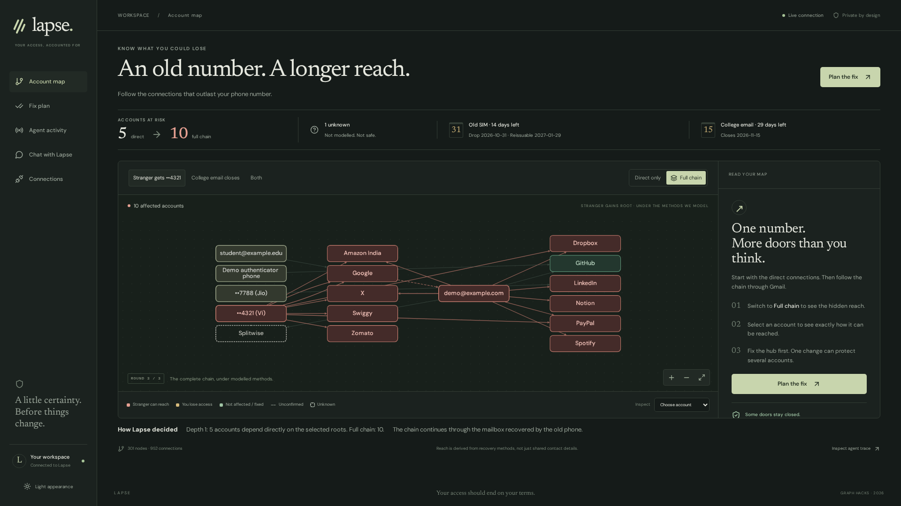
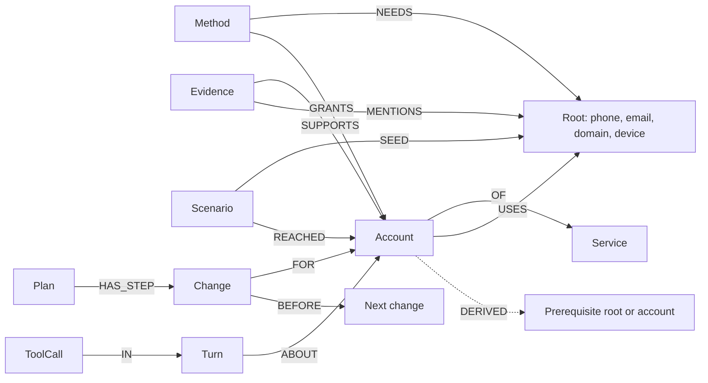

# Lapse

Find accounts that still depend on an old phone number or closing inbox, then plan their repair with your approval.



Princeton's 2021 study found that 171 of 259 recycled numbers, 66%, were still tied to accounts at major sites, with US numbers eligible for reissue after about 45 days; [college email accounts can also close after graduation](https://www.colgate.edu/about/campus-services-and-resources/managing-your-network-google-accounts/account-and-it-services). [Research and methodology](https://recyclednumbers.cs.princeton.edu/). In India, TRAI told the Supreme Court that disconnected numbers are not reassigned for at least 90 days, and the Court put responsibility for protecting privacy on the earlier subscriber in its [30 October 2023 order, W.P. 699/2021](https://api.sci.gov.in/supremecourt/2021/13468/13468_2021_3_45_47839_Judgement_30-Oct-2023.pdf).

## What it does

These results come from the fixture loaded into FalkorDB, **under the methods we model**.

| Scenario | Graph result |
| --- | --- |
| A stranger gets the old phone number | <!-- claim:takeover_phone_old.direct -->5<!-- /claim --> accounts directly reachable; <!-- claim:takeover_phone_old.full -->10<!-- /claim --> through the full chain. |
| The college email closes | <!-- claim:lockout_email_college.lost_now -->1<!-- /claim --> lost outright, even with the password; no way back if the password is forgotten: <!-- claim:lockout_email_college.recovery_lost -->4<!-- /claim -->. |
| The user loses both the old phone and college email | <!-- claim:compound_lockout.lost_now -->6<!-- /claim --> lost outright, even with the password; no way back if the password is forgotten: <!-- claim:compound_lockout.recovery_lost -->14<!-- /claim -->. |

The compound row is a user-lockout scenario, not a sum of attacker reach and user loss. An account can retain password sign-in while losing a recovery route. Missing recovery-loss results mean **not reported**, never zero. The old-phone scenario also has <!-- claim:takeover_phone_old.unknown -->1<!-- /claim --> unknown account. Unknown is not safe.

The fixture is synthetic. The separate live-demo setup uses test accounts and a Gmail inbox standing in for a college mailbox. Its closure notice is staged. The screenshot above is a recorded fixture run, not evidence of a real takeover or completed migration. See [demo setup](docs/persona-setup.md) and [UI verification](web/docs/verification.md).

## Why the graph is the product

A contact list can show which accounts mention a number. It cannot tell whether that number satisfies a recovery method or opens a mailbox that recovers another account.

Lapse uses an AND/OR closure. Any eligible method can grant an account, but every prerequisite within that method must be controlled. A stranger has the reassigned root and no passwords. A user keeps password knowledge and the possession roots they still hold. The closure repeats until it gains nothing.

**Depth 1** means the old number alone satisfies a method. **Full chain** also includes accounts reached through the recovered Gmail mailbox. Dropbox's model requires both the email reset and its enrolled SMS factor. The old number supplies SMS; the mailbox supplies the reset email. Treating those requirements as independent edges would report a takeover too early. An authenticator factor the stranger does not possess can block another branch.

The planner tries changes on graph copies and reruns the same evaluator. The phone plan reduces distinct affected accounts from <!-- claim:plan_phone_old.before -->11<!-- /claim --> to <!-- claim:plan_phone_old.after -->0<!-- /claim --> in <!-- claim:plan_phone_old.steps -->7<!-- /claim --> proposed steps. These are simulated outcomes, not completed external changes. Takeover and lockout can overlap, so the planner counts their union.

FalkorDB supplies the following mechanisms:

| Mechanism | Use and status |
| --- | --- |
| Multigraph | `lapse:u:<uid>` stores each user's accounts, evidence, conversation, scenarios, and plans. `lapse:policy` stores shared policies. Policies compile into each tenant because queries do not cross graphs. |
| `GRAPH.COPY` | The planner tests candidate changes in disposable sandboxes. A Redis lock serializes copies, with bounded retries for fork conflicts. |
| Variable-length paths | `wp4_mailbox_paths.cypher` walks `DERIVED*1..8` to identify reach through a mailbox host. Full explanations retain all required branches. |
| Full-text index | `view_search_evidence.cypher` searches evidence subjects and bounded snippets. |
| `algo.betweenness` | `keystones` tool and the map's "Fix first" line. Finds the nodes that single-factor chains pass through over password-free, single-need `ENABLES` edges. FalkorDB samples betweenness, so ranking uses the exact chain count (upstream × downstream) and reports the score as an estimate. |
| `algo.SPpaths` | `path_between` tool and the "shortest single-factor route" line in account details, e.g. old number → Google → Gmail → Notion in 3 hops. No route means the account needs several factors at once (AND), never "safe". Closure supplies the displayed counts. |
| Policy-event fan-out | Recompile affected accounts across tenant graphs, compare scenario outcomes, and notify changed tenants. Dry runs use copies. See [signals](docs/signals.md). |

Without FalkorDB, Lapse cannot resolve accounts, compute scenarios, choose fix order, retrieve evidence, or resume graph-backed plans. There is no separate in-memory answer engine. [The data model](docs/data-model.md) walks through the closure algorithm.

## Agent

Telegram is the ongoing conversation, in the Muse/Dots style. In the local `docker compose` stack the first private chat that messages the bot is linked to `LAPSE_UID` automatically; later chats are refused and must use a one-time link code (set `BOT_ALLOW_DEFAULT_UID=false` to always require one). The agent can alert you before you ask. Reissue countdowns, mailbox closure, domain expiry, stale contacts, new devices, and missed accounts trigger graph checks.

The same registry exposes <!-- claim:tools.count -->14<!-- /claim --> fixed MCP tools. The agent selects tools and explains results. It never writes Cypher. Every call is stored as a `ToolCall` node with tool arguments, named query, elapsed milliseconds, row count, and outcome, available from `GET /api/trace`. The web app is kept to the essentials (account map, fix plan, agent screen, connections); conversation happens in Telegram. The default transport calls the registry in-process; `AGENT_TOOL_TRANSPORT=mcp` uses MCP HTTP. [Tool contracts](docs/tools.md).

Typing "approve" asks for the approval controls. A human action authorizes execution. Telegram approval tokens are scoped, expiring, and single-use; the local web approval route queues the selected change.

| Tier | Who performs the change |
| --- | --- |
| T1 | The browser recipe uses an already authenticated session and reads required email proof automatically. |
| T2 | The browser pauses while you relay an SMS code. |
| T3 | You use a settings link and instructions. Evidence can verify completion when a supported confirmation is available. |
| T4 | You follow an offline checklist and reminders. No letter is submitted automatically. |

Browser recipes are candidates until tested against live accounts. See [executor validation](docs/exec-notes.md). The integration target is one OpenCode Go client using `https://opencode.ai/zen/go/v1`, model `kimi-k2.7-code`, and an `x-opencode-session` header. That client change is being integrated separately; the graph verifier needs no LLM key.

## Graph data model



| Entity | Meaning |
| --- | --- |
| `Root` | A phone, email, domain, or device the user may hold or lose. |
| `Account`, `Service` | A specific account and the service policy it uses. |
| `Method` | One access route, including password eligibility and all possession requirements. A mailbox method grants an Email root from its host Account. |
| `Evidence`, `Signal` | Observations supporting a relationship and events requiring attention. |
| `Scenario`, `DERIVED` | A question, its result, and the prerequisite branches behind the answer. |
| `Plan`, `Change` | Ordered repairs, approvals, execution status, and projected exposure. |
| `Turn`, `ToolCall` | Persistent conversation context and the query trace. |

| Relationship | Reasoning role |
| --- | --- |
| `USES` | Records a contact role. It does not prove access by itself. |
| `NEEDS`, `GRANTS` | Encode the AND within a method and the OR across granting methods. |
| `ENABLES` | A shortcut only for a password-free method with a single need. |
| `DERIVED` | Points from target to prerequisite for a particular scenario and baseline or reached result. |

The diagram shows the main relationships. [Full schema, properties, indexes, and policy graph](docs/data-model.md).

## The queries

There are <!-- claim:queries.count -->113<!-- /claim --> named `.cypher` files. The table below is generated from `lapse/graph/queries/` and [reviewed descriptions](docs/query-descriptions.json). `schema.cypher` holds index administration outside that count.

Start with [`closure_round.cypher`](lapse/graph/queries/closure_round.cypher). Its `all(x IN needs WHERE x IN $have)` condition is the AND gate. Zero-need methods require password knowledge. Disabled mailbox methods cannot grant access after closure.

For explain-path behavior, [`explain.cypher`](lapse/graph/queries/explain.cypher) returns the saved prerequisite branches. Python follows every branch to the chosen account and attaches evidence. A shortest path alone would omit part of an AND gate. [`wp4_mailbox_paths.cypher`](lapse/graph/queries/wp4_mailbox_paths.cypher) supplies the separate variable-length mailbox summary.

<details>
<summary>Every named query and its purpose</summary>

<!-- query-inventory -->
| Named query | Description |
| --- | --- |
| [account_evidence](lapse/graph/queries/account_evidence.cypher) | Find evidence supporting or mentioning path nodes. |
| [algo_keystones](lapse/graph/queries/algo_keystones.cypher) | Rank nodes that single-factor chains pass through; algo.betweenness estimate plus exact upstream x downstream chain count. |
| [algo_shortest_path](lapse/graph/queries/algo_shortest_path.cypher) | Shortest single-factor route between two nodes over ENABLES with algo.SPpaths. |
| [bot_confirm_use](lapse/graph/queries/bot_confirm_use.cypher) | Confirm a recorded account-to-root role. |
| [bot_dismiss_signal](lapse/graph/queries/bot_dismiss_signal.cypher) | Dismiss a signal. |
| [bot_remove_use](lapse/graph/queries/bot_remove_use.cypher) | Remove an incorrect account-to-root role. |
| [bot_signals](lapse/graph/queries/bot_signals.cypher) | List open signals by deadline. |
| [closure_round](lapse/graph/queries/closure_round.cypher) | Find targets whose complete method requirements are controlled. |
| [closure_seeds](lapse/graph/queries/closure_seeds.cypher) | Resolve the actor's initial controlled nodes. |
| [compile_accounts](lapse/graph/queries/compile_accounts.cypher) | Read active accounts and their root roles for compilation. |
| [compile_clear_enables](lapse/graph/queries/compile_clear_enables.cypher) | Remove materialized shortcuts for selected targets. |
| [compile_clear_methods](lapse/graph/queries/compile_clear_methods.cypher) | Remove selected policy methods while preserving observed methods. |
| [compile_enables](lapse/graph/queries/compile_enables.cypher) | Materialize password-free methods with exactly one need. |
| [compile_mailboxes](lapse/graph/queries/compile_mailboxes.cypher) | Match open email roots to their active hosting accounts. |
| [compile_methods](lapse/graph/queries/compile_methods.cypher) | Create compiled methods and their grant targets. |
| [compile_needs](lapse/graph/queries/compile_needs.cypher) | Attach every required prerequisite to a method. |
| [compile_policy_events](lapse/graph/queries/compile_policy_events.cypher) | Load persisted policy events so recompiles keep post-event methods. |
| [compile_targets](lapse/graph/queries/compile_targets.cypher) | Find targets affected by selected account methods. |
| [demo_phone_values](lapse/graph/queries/demo_phone_values.cypher) | Set demo phone numbers on the fixture's phone roots. |
| [exec_context](lapse/graph/queries/exec_context.cypher) | Read the change, account, and old and new roots. |
| [exec_pending](lapse/graph/queries/exec_pending.cypher) | Find released running or assisted changes and their evidence. |
| [exec_release](lapse/graph/queries/exec_release.cypher) | Release a change's active executor claim. |
| [exec_start](lapse/graph/queries/exec_start.cypher) | Atomically claim an approved change for execution. |
| [explain](lapse/graph/queries/explain.cypher) | Read scenario derivation branches, using the baseline for lockout. |
| [fixture_accounts](lapse/graph/queries/fixture_accounts.cypher) | Create fixture accounts and service relationships. |
| [fixture_evidence](lapse/graph/queries/fixture_evidence.cypher) | Create fixture evidence and its account and root links. |
| [fixture_method_counts](lapse/graph/queries/fixture_method_counts.cypher) | Report compiled method counts per fixture account. |
| [fixture_roots_device](lapse/graph/queries/fixture_roots_device.cypher) | Create fixture device roots. |
| [fixture_roots_domain](lapse/graph/queries/fixture_roots_domain.cypher) | Create fixture domain roots. |
| [fixture_roots_email](lapse/graph/queries/fixture_roots_email.cypher) | Create fixture email roots. |
| [fixture_roots_phone](lapse/graph/queries/fixture_roots_phone.cypher) | Create fixture phone roots. |
| [fixture_user](lapse/graph/queries/fixture_user.cypher) | Create the fixture user record. |
| [fixture_uses](lapse/graph/queries/fixture_uses.cypher) | Create fixture account-to-root roles with evidence metadata. |
| [get_scenario](lapse/graph/queries/get_scenario.cypher) | Read a saved scenario result. |
| [graph_edge_count](lapse/graph/queries/graph_edge_count.cypher) | Count all relationships in the selected graph. |
| [graph_node_count](lapse/graph/queries/graph_node_count.cypher) | Count all nodes in the selected graph. |
| [ingest_account](lapse/graph/queries/ingest_account.cypher) | Merge a discovered account, service, and supporting evidence. |
| [ingest_account_candidates](lapse/graph/queries/ingest_account_candidates.cypher) | Find existing accounts for a service so a changed email keeps the same account. |
| [ingest_closing_email](lapse/graph/queries/ingest_closing_email.cypher) | Apply a closure notice unless a newer notice exists. |
| [ingest_mentions](lapse/graph/queries/ingest_mentions.cypher) | Link evidence to mentioned roots. |
| [ingest_repoint](lapse/graph/queries/ingest_repoint.cypher) | Remove superseded contact roles unless newer evidence exists. |
| [ingest_role_roots](lapse/graph/queries/ingest_role_roots.cypher) | Read roots associated with a role at the observation time. |
| [ingest_root_device](lapse/graph/queries/ingest_root_device.cypher) | Create a discovered device root if absent. |
| [ingest_root_email](lapse/graph/queries/ingest_root_email.cypher) | Create a discovered email root if absent. |
| [ingest_root_phone](lapse/graph/queries/ingest_root_phone.cypher) | Create a discovered phone root if absent. |
| [ingest_roots](lapse/graph/queries/ingest_roots.cypher) | Read roots for ingestion matching. |
| [ingest_service_counts](lapse/graph/queries/ingest_service_counts.cypher) | Count discovered accounts by service. |
| [ingest_signal](lapse/graph/queries/ingest_signal.cypher) | Merge an ingestion signal and its root link. |
| [ingest_summary](lapse/graph/queries/ingest_summary.cypher) | Count discovery records, confirmed uses, and unknown services. |
| [ingest_use](lapse/graph/queries/ingest_use.cypher) | Merge a root role without overwriting newer contact evidence. |
| [onboarding_declared_use](lapse/graph/queries/onboarding_declared_use.cypher) | Confirm a declared dependency for a discovered account matched by service and login email. |
| [onboarding_device](lapse/graph/queries/onboarding_device.cypher) | Merge declared device metadata. |
| [onboarding_email](lapse/graph/queries/onboarding_email.cypher) | Merge declared email metadata while preserving observed closure notices. |
| [onboarding_phone](lapse/graph/queries/onboarding_phone.cypher) | Merge declared phone metadata. |
| [onboarding_user](lapse/graph/queries/onboarding_user.cypher) | Merge the user's onboarding metadata. |
| [planner_candidates](lapse/graph/queries/planner_candidates.cypher) | Group the old root's roles by active account. |
| [planner_change_evidence](lapse/graph/queries/planner_change_evidence.cypher) | Attach completion evidence to a change and its account. |
| [planner_closing_accounts](lapse/graph/queries/planner_closing_accounts.cypher) | Find mailbox hosting accounts that close and cannot be migrated. |
| [planner_drop_use](lapse/graph/queries/planner_drop_use.cypher) | Remove the selected old-root roles in a simulation or completed change. |
| [planner_get_change](lapse/graph/queries/planner_get_change.cypher) | Read one persisted change. |
| [planner_get_plan](lapse/graph/queries/planner_get_plan.cypher) | Read a plan with its ordered changes. |
| [planner_list_plans](lapse/graph/queries/planner_list_plans.cypher) | List plans and their ordered changes, newest first. |
| [planner_repoint_use](lapse/graph/queries/planner_repoint_use.cypher) | Move selected roles to a replacement root, preserving metadata. |
| [planner_roots](lapse/graph/queries/planner_roots.cypher) | Resolve old and replacement roots. |
| [planner_save_plan](lapse/graph/queries/planner_save_plan.cypher) | Persist the plan summary and exposure counts. |
| [planner_save_steps](lapse/graph/queries/planner_save_steps.cypher) | Persist changes and their plan and account links. |
| [planner_step_order](lapse/graph/queries/planner_step_order.cypher) | Connect consecutive changes with BEFORE edges. |
| [planner_update_change](lapse/graph/queries/planner_update_change.cypher) | Update a change's status and optional note. |
| [policy_carriers](lapse/graph/queries/policy_carriers.cypher) | Write carrier reassignment rules. |
| [policy_changes](lapse/graph/queries/policy_changes.cypher) | Write contact-change procedures and service links. |
| [policy_clear](lapse/graph/queries/policy_clear.cypher) | Clear the selected policy graph before a full reload. |
| [policy_methods](lapse/graph/queries/policy_methods.cypher) | Write method templates and their service links. |
| [policy_service](lapse/graph/queries/policy_service.cypher) | Merge service policy metadata. |
| [scenario_account](lapse/graph/queries/scenario_account.cypher) | Resolve an account for an explanation. |
| [scenario_accounts](lapse/graph/queries/scenario_accounts.cypher) | Read accounts and their directly associated roots. |
| [scenario_context](lapse/graph/queries/scenario_context.cypher) | Read roots for scenario seed selection. |
| [scenario_disabled](lapse/graph/queries/scenario_disabled.cypher) | Find mailbox methods disabled by email loss. |
| [scenario_old](lapse/graph/queries/scenario_old.cypher) | Find scenarios beyond the retention limit. |
| [scenario_prune](lapse/graph/queries/scenario_prune.cypher) | Delete expired scenario records and their links. |
| [scenario_prune_derivations](lapse/graph/queries/scenario_prune_derivations.cypher) | Delete derivations belonging to expired scenarios. |
| [scenario_timing](lapse/graph/queries/scenario_timing.cypher) | Persist scenario timing and its serialized result. |
| [signals_detector_adopt](lapse/graph/queries/signals_detector_adopt.cypher) | Consolidate equivalent signals while preserving dismissal and delivery state. |
| [signals_detector_devices](lapse/graph/queries/signals_detector_devices.cypher) | Find old authenticator roots implicated by new-device evidence. |
| [signals_detector_expiry](lapse/graph/queries/signals_detector_expiry.cypher) | Store a discovered domain expiration on its root. |
| [signals_detector_merge](lapse/graph/queries/signals_detector_merge.cypher) | Upsert a detector signal without reopening dismissed signals. |
| [signals_detector_missed](lapse/graph/queries/signals_detector_missed.cypher) | Find accounts mentioned after a root migration without their own change. |
| [signals_detector_notified](lapse/graph/queries/signals_detector_notified.cypher) | Mark a detector signal's notification delivered. |
| [signals_detector_pending](lapse/graph/queries/signals_detector_pending.cypher) | Find open detector signals awaiting notification. |
| [signals_detector_roots](lapse/graph/queries/signals_detector_roots.cypher) | Read roots and evidence dates for detector checks. |
| [signals_policy_accounts](lapse/graph/queries/signals_policy_accounts.cypher) | Select active service accounts not exempt from a policy event. |
| [signals_policy_event](lapse/graph/queries/signals_policy_event.cypher) | Persist a policy event or its tenant delivery state. |
| [signals_policy_pending](lapse/graph/queries/signals_policy_pending.cypher) | Read a pending policy-event notification. |
| [signals_synth_owner](lapse/graph/queries/signals_synth_owner.cypher) | Check a graph's synthetic ownership marker before cleanup. |
| [view_accounts](lapse/graph/queries/view_accounts.cypher) | List accounts or select one account. |
| [view_derived](lapse/graph/queries/view_derived.cypher) | Read actual reached derivations for the scenario graph view. |
| [view_evidence](lapse/graph/queries/view_evidence.cypher) | Read an account's supporting evidence, newest first. |
| [view_label_counts](lapse/graph/queries/view_label_counts.cypher) | Count graph nodes by label. |
| [view_methods](lapse/graph/queries/view_methods.cypher) | Read methods, grant targets, and all required roots. |
| [view_roots](lapse/graph/queries/view_roots.cypher) | List user roots. |
| [view_scenario](lapse/graph/queries/view_scenario.cypher) | Read a scenario and its reached nodes and rounds. |
| [view_search_evidence](lapse/graph/queries/view_search_evidence.cypher) | Search the Evidence full-text index by relevance. |
| [view_uses](lapse/graph/queries/view_uses.cypher) | Read account-to-root roles, confidence, and evidence IDs. |
| [wp4_accounts](lapse/graph/queries/wp4_accounts.cypher) | Read accounts with their service metadata for resolution. |
| [wp4_entity](lapse/graph/queries/wp4_entity.cypher) | Resolve a typed graph entity by application ID. |
| [wp4_mailbox_paths](lapse/graph/queries/wp4_mailbox_paths.cypher) | Walk variable-length DERIVED paths to identify mailbox-host reach. |
| [wp4_trace_list](lapse/graph/queries/wp4_trace_list.cypher) | Read tool calls after an optional timestamp. |
| [wp4_trace_write](lapse/graph/queries/wp4_trace_write.cypher) | Persist a tool call's query trace and optional turn link. |
| [wp4_turn_about](lapse/graph/queries/wp4_turn_about.cypher) | Link a conversation turn to mentioned accounts and roots. |
| [wp4_turn_history](lapse/graph/queries/wp4_turn_history.cypher) | Read recent conversation turns. |
| [wp4_turn_write](lapse/graph/queries/wp4_turn_write.cypher) | Persist a conversation turn and its context. |
| [write_derivation](lapse/graph/queries/write_derivation.cypher) | Persist every prerequisite branch of a scenario derivation. |
| [write_reached](lapse/graph/queries/write_reached.cypher) | Persist reached nodes with their round and granting method. |
| [write_scenario](lapse/graph/queries/write_scenario.cypher) | Persist a scenario and its initial seed links. |
<!-- /query-inventory -->

</details>

## Run locally

Use Python 3.12, uv, and Docker Compose v2. Configure private credentials as described in [local deployment](docs/deploy.md). Keep `.env` and `persona.local.yaml` out of version control.

```sh
uv sync --extra browser
make up                         # start FalkorDB before doctor checks it
make doctor
make demo
make fixture
uv run python scripts/verify_claims.py
```

Doctor currently flags the running database ports as occupied while also requiring that database for its graph check. Inspect its output and resolve other failures; those expected port warnings do not require stopping FalkorDB.

Open <http://localhost:8080>. FalkorDB is on `localhost:6380`; its Browser is on `localhost:3001`. `make fixture` replaces the shared demo and policy graphs. Coordinate that reload if another checkout is using them. The verifier loads its own disposable fixture instead.

To prove the whole loop on the demo persona without touching real accounts, run `uv run python scripts/demo_e2e.py` (detect → plan → approve → execute → verify, clearly labelled as a simulation). `make demo-down` stops the stack and keeps local data.

```sh
uv run ruff check .
uv run pytest -m 'not db' -q
uv run pytest -m db -q
uv run python scripts/verify_claims.py --write  # refresh marked claims and query table
uv run python scripts/verify_claims.py --uid demo  # check a copy of the existing graph
```

[Claim verification](docs/claims.md) explains the registry, timing tolerance, and optional test count. CI runs lint, unit tests, database tests against FalkorDB v4.22.1, and claim checks.

## Privacy and threat model

The graph is a takeover map. Someone who reads it can learn account identifiers, recovery dependencies, deadlines, and the most useful accounts to target. Local deployment reduces exposure; it does not make that data harmless.

Lapse stores account metadata, root relationships, evidence message IDs and headers, snippets of at most 300 characters, plans, and traces. Full email bodies and account passwords are not persisted. OTPs never enter the graph or trace; the relay keeps them briefly in Redis. Inbox app passwords are encrypted locally. Browser profiles retain session cookies and are **not application-encrypted**. Treat the database, profiles, screenshots, and encryption keys as sensitive.

The local API's tenant header is a selector, not authentication. Screenshot files are not authorized per tenant. Read-only demo mode blocks external actions and ingestion, but does not provide private-data access control. Do not expose personal graphs through a public tunnel. [Storage details](docs/api.md) and [executor limits](docs/exec-notes.md).

## Honest limits

- Accounts opened with "Sign in with Google" are not modelled yet.
- Every risk result holds **under the methods we model**. Unknown is not safe, including when projected exposure reaches zero.
- Public help pages do not reveal every adaptive recovery challenge. Gmail access through a number is a modeled branch, not a guarantee. Missing MFA evidence is not proof that MFA is off.
- Password knowledge preserves some fresh sign-ins after mailbox loss. Recovery loss is a separate result; older responses do not report it.
- Supplied browser recipes remain unvalidated until a live change and a settings reload prove the old contact is gone. Current UI screenshots verify transport and graph behavior, not vendor execution.
- Policy replay is a limited historical simulation. Later compilation can reload the original YAML unless persisted events are reapplied.
- Carrier dates are earliest possible reassignment dates after disconnection, not predictions. University mailbox rules vary.

See [policy sources and caveats](docs/policy-notes.md).

## Tracks

- **Track 01, Agents That Act on Connected Data, primary.** Graph-derived paths choose and explain repairs, then human approvals permit actions.
- **Track 02, Agent Memory & Coordination.** Per-user graphs retain evidence, conversations, plans, and traces across restarts; shared policies drive tenant-specific checks.

## AI assistance disclosure

Built with AI coding agents, with Claude Code coordinating Codex agents. The team designed the system, reviewed changes, and verified the work. AI assistance covered implementation, tests, and documentation. Live-account verification gaps are disclosed above.

## Demo video

Demo video: recording link pending.
