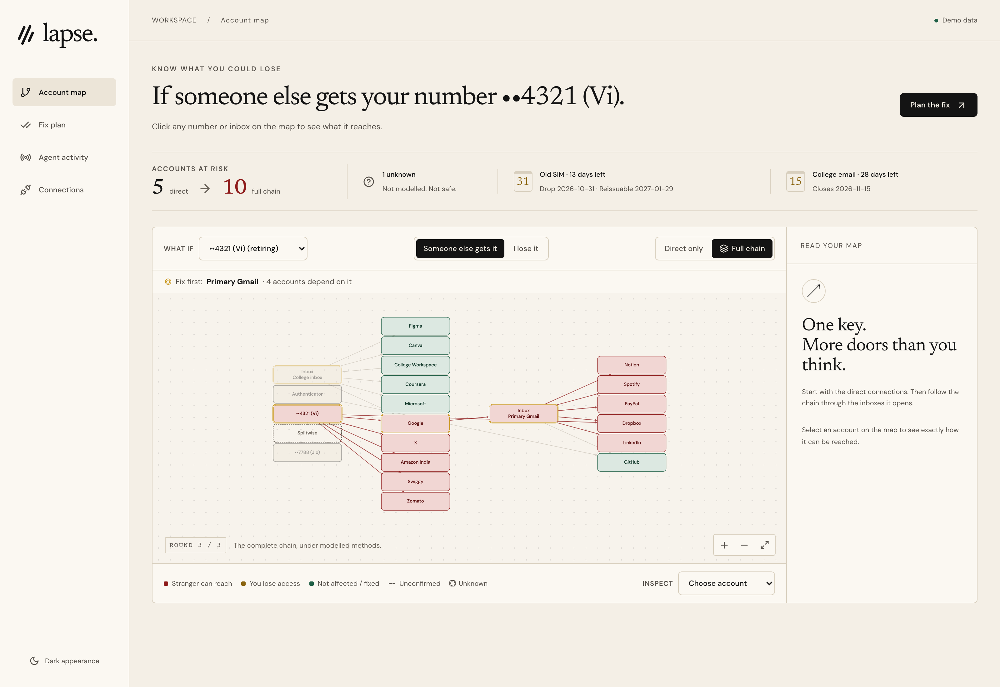
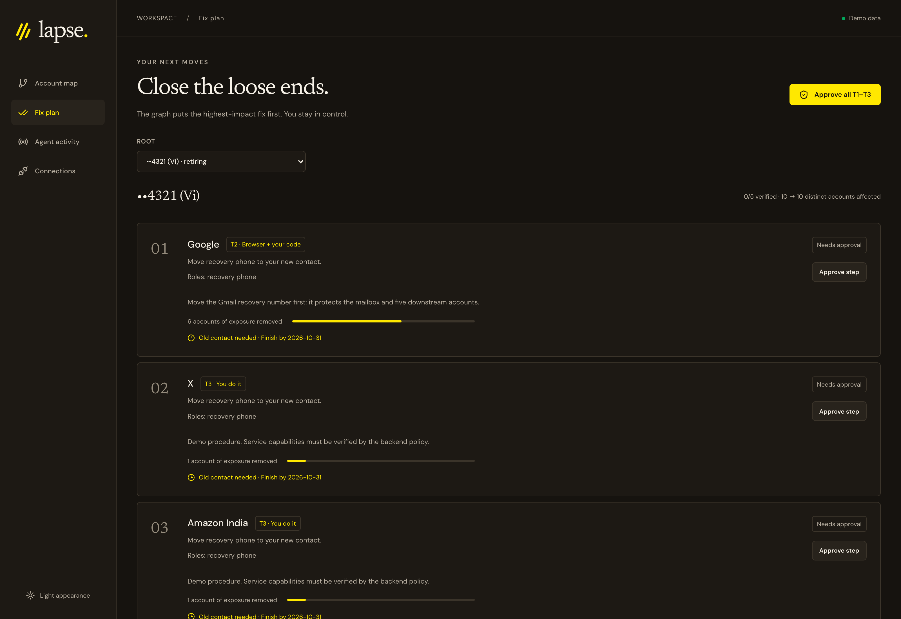
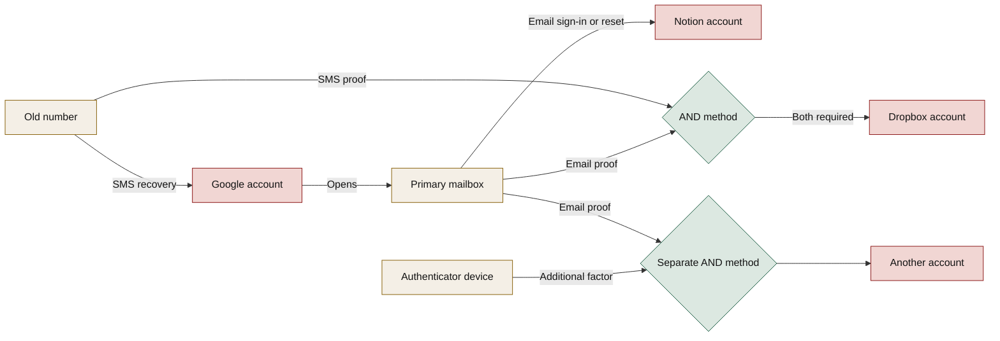
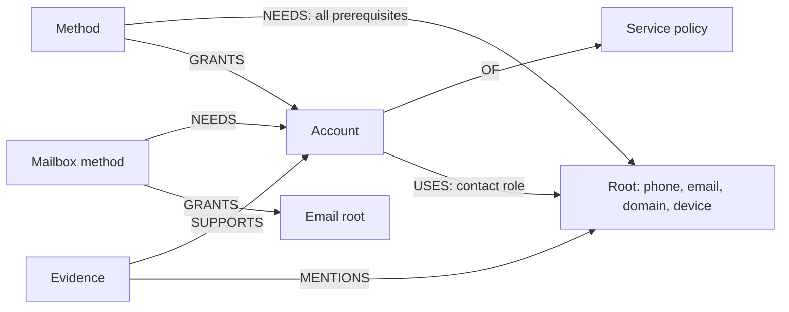
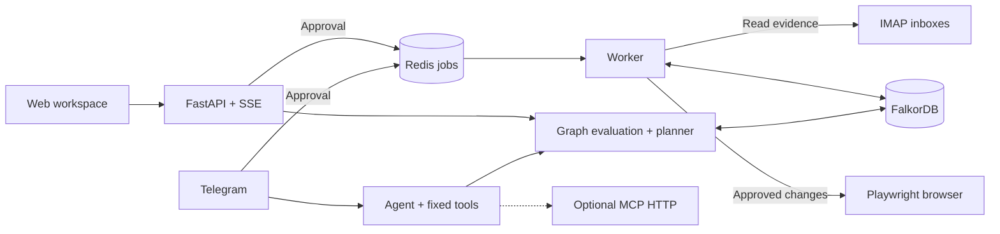

<p align="center">
  <picture>
    <source media="(prefers-color-scheme: dark)" srcset="docs/assets/lapse-logo-dark.png">
    
  </picture>
</p>

# Lapse

**Know what you could lose. Fix the dependencies before you lose it.**

Lapse is a Telegram-first agent that finds accounts still tied to a phone number, email address, or domain you are giving up. It models their recovery dependencies in **FalkorDB**, explains the risks across multiple hops, and plans changes you can approve.

One recycled number can unlock a mailbox. That mailbox can recover other accounts. Lapse looks beyond the first connection to show the chain, the factors that block it, and which change to make first.

[](https://github.com/tejas-raskar/lapse/actions/workflows/ci.yml)

[Features](#features) · [Why a graph](#why-a-graph) · [Run locally](#run-locally) · [Development and tests](#development-and-tests) · [Documentation](#documentation) · [Limitations](#limitations)

## Features

| Capability | What it gives you |
| --- | --- |
| **Telegram-first agent** | Ask questions in natural language, receive risk alerts, review plans, and approve changes. The web app is for visualization and configuration, not a second chat interface. |
| **Evidence-backed discovery** | Extract account and contact relationships from configured IMAP inboxes. Declare dependencies that messages cannot establish, such as an enrolled SMS factor. |
| **Interactive account map** | Select a number or inbox, choose **Someone else gets it** or **I lose it**, and compare **Direct only** with the **Full chain**. |
| **Multi-factor reasoning** | Evaluate alternative access methods and combinations of required factors, not just whether two nodes share an edge. |
| **Explainable risk** | Follow the prerequisite branches and supporting evidence behind an affected account. Distinguish immediate lockout from loss of recovery. |
| **Graph-based prioritization** | Find dependency hubs and shortest single-factor routes, with AND-method limitations made explicit. |
| **Ordered repair plans** | Simulate candidate changes in graph copies, recompute exposure, and prioritize repairs while required old contacts are still available. |
| **Approval-based execution** | Use supported browser recipes, relay an SMS code when required, or follow assisted/offline steps. Watch the latest browser view in **Agent activity**. |
| **Ongoing monitoring** | Check reassignment deadlines, mailbox closure, domain expiry, stale contacts, new devices, and missed accounts; notify linked Telegram users when relevant signals appear. |
| **Persistent agent context** | Keep evidence, conversations, scenarios, plans, and tool/query traces in per-user graphs. Fixed tools are also exposed through MCP. |

**Execution is service-specific.** The Notion email-change recipe has live validation for a personal, unmanaged account. Canva and X recipes are candidates, not validated integrations. See [execution support and validation](docs/exec-notes.md).

### A short walkthrough

1. Connect the inboxes and declare the numbers or addresses you are retiring.
2. Ask Telegram: **“What happens if someone gets my old number?”**
3. Use **Show me** to open that scenario on the account map.
4. Ask **“What should I fix first?”**, then build a plan with **Fix it for me**.
5. Review the proposed changes. Approve only the actions you want performed.
6. Follow any required code or manual step; inspect the updated graph and execution state.

Other useful questions include **“What if I lose my college email?”**, **“How does my number lead to Notion?”**, and **“Is my Microsoft account affected?”** Failed or incomplete checks are reported as incomplete, not treated as evidence that an account is unaffected.

### The workspace

**Account map · Newsprint light theme**



**Fix plan · Risograph dark theme**



These images show the current UI using its **synthetic frontend preview data**, not a live user's accounts. The plan is a visual example, not a completed migration or proof of vendor execution. Preview procedures and counts are illustrative; the independently verified graph results below come from the backend fixture. [Screenshot provenance](web/docs/verification.md#readme-assets).

## Why a graph

A contact list can tell you which accounts mention a phone number. It cannot tell you whether that number satisfies an access method, opens an inbox, or combines with another factor to recover an account several steps away.

### Follow the whole chain



This is an **illustrative control-flow diagram**, not the literal direction of every stored edge or a guarantee about a service's current recovery flow. The number can lead through the mailbox to Notion. The Dropbox branch requires **both** email and SMS. A branch requiring an authenticator remains blocked for a stranger who does not possess that device.

Lapse evaluates **OR across methods, AND within each method**:

- A node is controlled if it is a seed, or **any** eligible method granting it has **all** its prerequisites controlled.
- The user knows passwords; a stranger does not. A method with no possession prerequisites must still require a password.
- A mailbox is reached through its hosting account. It is not automatically available merely because its address appears in the graph.
- The evaluator repeats until no new nodes can be reached. A cycle cannot start itself without an entry point.

For lockout, Lapse compares access before and after losing the selected roots. It separately reports accounts lost **even with the password** and accounts that lose their **password-free recovery route**. The same account can appear in both groups; totals use distinct accounts.

### The stored model



`USES` records a dependency, not proof of access. `NEEDS` and `GRANTS` encode the access logic. A Google `Account` and its email `Root` are deliberately separate: one is the host login, the other is the mailbox downstream accounts depend on. Saved `DERIVED` relationships preserve prerequisite branches for explanations. Evidence retains message metadata and a bounded snippet. [Full graph schema and semantics](docs/data-model.md).

### What FalkorDB does

| Mechanism | Role in Lapse |
| --- | --- |
| **Named Cypher queries** | Perform account lookup, access-method evaluation, evidence retrieval, scenario persistence, and plan updates. The LLM never writes Cypher. |
| **AND/OR closure** | [`closure_round.cypher`](lapse/graph/queries/closure_round.cypher) checks complete prerequisite sets; a Python loop advances rounds using database results. |
| **`GRAPH.COPY`** | Test repair candidates in disposable graph sandboxes before proposing an ordered plan. |
| **`algo.SPpaths` and `algo.betweenness`** | Find shortest routes and dependency hubs over password-free, single-prerequisite `ENABLES` edges. These are lower-bound analyses; they do not replace AND/OR closure. |
| **Per-user graphs** | `lapse:u:<uid>` holds each user's model and history. Shared policies live in `lapse:policy` and compile into user graphs; queries never cross graph boundaries. |
| **Evidence and memory** | Store explanations, conversations, plans, signals, and tool/query traces alongside the relationships they refer to. |

**No single-factor path does not mean safe.** An AND method may still combine several factors. Full scenario counts and explanations come from the closure evaluator, not a shortest-path algorithm.

Without FalkorDB, Lapse cannot compute risk, recover evidence-backed explanations, order repairs, or resume graph-backed plans. There is no separate in-memory reasoning engine that substitutes for the graph.

### Reproducible fixture results

These are **synthetic backend fixture results, under the methods we model**, checked by the [claim verifier](docs/claims.md). They are not live-account measurements.

| Question | Verified result |
| --- | --- |
| A stranger gets the old number | <!-- claim:takeover_phone_old.direct -->5<!-- /claim --> accounts directly reachable; <!-- claim:takeover_phone_old.full -->10<!-- /claim --> through the full chain; <!-- claim:takeover_phone_old.unknown -->1<!-- /claim --> unknown. |
| The college inbox closes | <!-- claim:lockout_email_college.lost_now -->1<!-- /claim --> account lost immediately; <!-- claim:lockout_email_college.recovery_lost -->4<!-- /claim --> lose recovery. |
| Replace the old number, following the proposed plan | Distinct affected accounts: <!-- claim:plan_phone_old.before -->11<!-- /claim --> before, <!-- claim:plan_phone_old.after -->0<!-- /claim --> projected after, across <!-- claim:plan_phone_old.steps -->7<!-- /claim --> proposed steps. |

The phone plan counts the union of takeover and lockout exposure, so its starting count differs from takeover alone. Projected zero exposure is **not** a safety guarantee for unmodelled methods or unknown services. A simulated repair is not an executed account change.

## Architecture



FalkorDB and Redis jobs/state use the same local database service. The worker handles ingestion, approved execution, verification, and scheduled checks. Playwright uses a locally authenticated browser profile. The bot uses **long polling**, so Telegram needs no incoming webhook or public server. The default tool transport is in-process; MCP HTTP is optional. Query timing, row counts, and outcomes remain available through `GET /api/trace` even though the UI intentionally hides the tool-trace panel.

## Run locally

### Prerequisites

- **Docker** with Compose v2, running locally.
- **Python 3.12** managed with [uv](https://docs.astral.sh/uv/).
- A **Telegram bot token** from [BotFather](https://t.me/BotFather).
- An API key and model for an **OpenAI-compatible LLM provider**.
- IMAP access to the inboxes you want to scan, using app passwords where required. Use test accounts while evaluating automated changes.

Node.js 22 is needed only for frontend development. The Docker worker includes Chromium; a host Chromium installation is needed for the optional headed-browser workflow below.

### 1. Clone and prepare local configuration

```sh
git clone https://github.com/tejas-raskar/lapse.git
cd lapse
uv sync --extra browser
cp -n .env.example .env
cp -n persona.local.example.yaml persona.local.yaml
make keys
```

On a fresh clone, edit the two local files. `cp -n` leaves existing files intact. Copy the two generated keys into `.env`; keep them private and stable across restarts.

| Setting | Configure locally |
| --- | --- |
| `LAPSE_UID` | One user ID for the API, bot, worker, and setup commands. The public template uses `demo`; use that consistently in the commands below. |
| `TELEGRAM_BOT_TOKEN` | Your bot's token. Also add `TELEGRAM_BOT_USERNAME` with its handle, without `@`, so the web link opens your bot. |
| `LLM_BASE_URL`, `LLM_API_KEY`, `LLM_MODEL` | Your provider settings. The template shows OpenCode Go; its session header is supplied by the client. Model availability and provider access are external requirements. |
| `PRIMARY_IMAP_HOST`, `PRIMARY_IMAP_USER`, `PRIMARY_IMAP_PASSWORD` | Server, address, and app password for `email_primary`. |
| `COLLEGE_IMAP_HOST`, `COLLEGE_IMAP_USER`, `COLLEGE_IMAP_PASSWORD` | Corresponding settings for `email_college`. Both inboxes are used by the default two-inbox scan. |
| `LAPSE_SECRET_KEY`, `APPROVAL_SIGNING_KEY` | The keys printed by `make keys`: inbox encryption and approval signing. |
| `FALKORDB_HOST`, `FALKORDB_PORT` | Keep the template's host connection at `localhost:6380`. Compose supplies `falkordb:6379` inside containers. |
| `LAPSE_DEMO_MODE` | Keep `false` for discovery and approved changes. `true` blocks external-action/ingestion routes; it is not authentication. |

In `persona.local.yaml`, replace the placeholder phone numbers and addresses, set actual statuses and dates, and keep mailbox addresses aligned with the IMAP settings. Remove template declarations that are not true for your accounts. The college inbox can be a test mailbox; its closing status/date is a declaration, not a real service shutdown.

**Do not commit either private file, generated keys, or browser profiles.** Only declare relationships you have actually configured. The [persona guide](docs/persona-setup.md) describes the test-account setup.

### 2. Start the graph, load your roots, and start the stack

```sh
make up
uv run python -m lapse.onboarding --uid demo
make demo
docker compose ps
```

`make up` starts FalkorDB. The onboarding command loads the local persona and declared dependencies; it does not scan email. `make demo` builds and starts the API, web app, worker, bot, and MCP service. The persona file must already exist because Compose mounts it read-only.

| Service | Local address |
| --- | --- |
| Web workspace | <http://localhost:8080> |
| API and interactive API docs | <http://localhost:8000/docs> |
| FalkorDB Browser | <http://localhost:3001> |
| FalkorDB / Redis | `localhost:6380` |
| MCP streamable HTTP | `http://localhost:8766/mcp` |

### 3. Discover accounts and link Telegram

With the configured inboxes and persona ready, run:

```sh
uv run python scripts/ingest_live.py --uid demo --live
```

This **reads real configured email** and updates your local graph. It does not change external account settings. For one inbox only, use **Connections** to connect that inbox and start discovery instead; the CLI's default scan expects both `email_primary` and `email_college`.

Open the workspace and inspect **Connections** and **Account map**. In the local Compose stack, the **first private Telegram chat** that messages the bot can link to `LAPSE_UID` automatically. Open your bot and send `/start`, then `/risk`.

For explicit linking, set `BOT_ALLOW_DEFAULT_UID=false` in `.env` and recreate the bot with `docker compose up -d bot`. Use **Connections → Link Telegram** to get a one-time code, then send `/start <code>` to your bot. Other private chats cannot silently claim an already linked user.

Try the walkthrough questions above. Web links use the local host address: open them on the computer running Lapse, not on a phone that interprets `localhost` as itself.

### 4. Enable a supported browser action

Graph analysis and plan simulation do not require a logged-in browser. Real automatic execution does: the agent never asks for an account password or handles an interactive login for you.

For a **headed Notion demo on the host**, stop the Docker worker first:

```sh
docker compose stop worker
uv run playwright install chromium
uv run python scripts/browser_login.py --service notion --uid demo
EXEC_HEADED=true uv run python -m lapse.worker
```

Sign in manually in the login window and close it as instructed before starting the worker. Both old and replacement inboxes must be accessible for the validated Notion flow. Build a plan and approve the relevant step through Telegram; **Agent activity** shows the latest browser screenshot.

Keep the login profile and executor on the same operating system. Do not assume macOS browser cookies can be reused by Linux Chromium in Docker, and never run two workers against one profile. Stop the host worker with Ctrl-C before returning to `docker compose start worker`.

| Tier | Execution mode |
| --- | --- |
| **T1** | Supported browser recipe with required email proof read automatically. |
| **T2** | Browser-assisted change that pauses for a human-relayed SMS code. |
| **T3** | Settings link and guided manual change; supported evidence may verify completion. |
| **T4** | Offline checklist and reminders. No letter or request is submitted automatically. |

Typing “approve” in chat does not itself authorize execution. Human approval controls authorize specific changes. [Recipe requirements, validation, and fallback behavior](docs/exec-notes.md).

### Operations and troubleshooting

```sh
make logs s=worker          # Follow one service; Ctrl-C stops following logs
docker compose restart bot # Restart without rebuilding
make demo-down             # Stop services; retain local data and browser profiles
```

| Symptom | Check |
| --- | --- |
| Bot asks for a code | Use Connections to link explicitly; verify the bot handle and `LAPSE_UID`. Do not run two polling bots with the same token. |
| No accounts after setup | Loading roots is not discovery. Run the scan or connect an inbox; check the worker and inbox configuration. |
| IMAP authentication fails | Enable provider-required IMAP/app-password access and match each inbox address to its persona root. |
| Browser step needs login or becomes assisted | Prepare the profile on the executor's OS. Password challenges and unsupported UI flows require manual intervention, not a fabricated success. |
| Web shows an API error after an API rebuild | Check `docker compose ps`, then `docker compose restart web` so nginx resolves the current API container. |
| A port is occupied | Use the listed host ports; do not stop unrelated processes. FalkorDB uses 6380/3001, not 6379/3000, on the host. |

`make doctor` checks host dependencies, configured services, LLM access, and inbox login without printing credentials. It makes external connectivity checks and may report ports occupied by your already-running stack; a container-only browser does not need host Chromium. [Deployment reference](docs/deploy.md).

<details>
<summary>Optional: load the synthetic backend fixture</summary>

On a **separate disposable setup**, with FalkorDB running:

```sh
make fixture
```

**This replaces `lapse:u:demo` and `lapse:policy`.** It is not an onboarding step for personal accounts and must not be run against data you want to keep. The fixture needs no live inbox or LLM calls.

For non-destructive numerical verification, use the claim-checking command below instead; it creates and deletes its own uniquely named fixture graph.

</details>

## Development and tests

The repository uses Python 3.12, uv, pytest, Ruff, TypeScript, Vite, Vitest, and Playwright. Database tests are marked `db` and use isolated test graphs.

```sh
uv sync --extra browser
uv run playwright install --with-deps chromium
make lint
make test                  # Python tests excluding the db marker
make up
make test-db               # Requires FalkorDB v4.22.1 on localhost:6380
uv run python scripts/verify_claims.py
```

The claim verifier evaluates scenarios and plans against a disposable synthetic graph. It needs FalkorDB, not inbox credentials or an LLM call. It checks marked numerical claims and the named-query description registry.

For the frontend:

```sh
cd web
npm ci
npm test
npm run build              # TypeScript compilation and production bundle
VITE_API_URL=http://localhost:8000 VITE_USE_MOCK=false npm run dev
```

Open <http://localhost:5173>; run `make api` in another terminal if the Docker API is not running. For a frontend-only synthetic preview, use `VITE_USE_MOCK=true npm run dev`. That mode does **not** exercise FalkorDB or external account changes.

[CI](.github/workflows/ci.yml) runs Python lint, unit tests, FalkorDB integration tests, and documentation claim checks. Frontend tests and the production build are separate local checks, not currently jobs in that workflow.

Coverage includes AND/OR closure, multi-hop paths, compound loss, plan simulations, tenant boundaries, ingestion identity/replay, approval controls, browser-runner behavior, and UI state transitions. Passing tests do not imply every live service integration has been validated.

## Documentation

| Reference | Contents |
| --- | --- |
| [Graph model](docs/data-model.md) | Nodes, edges, indexes, compilation, actors, closure, and lockout semantics. |
| [Named queries](lapse/graph/queries) | <!-- claim:queries.count -->116<!-- /claim --> query files; start with [closure](lapse/graph/queries/closure_round.cypher) and [explanations](lapse/graph/queries/explain.cypher). |
| [Tools and MCP](docs/tools.md) | <!-- claim:tools.count -->14<!-- /claim --> registered fixed tools, arguments, results, and trace outcomes. |
| [API](docs/api.md) | Routes, storage, events, and local tenant selection. |
| [Deployment](docs/deploy.md) | Local services, configuration, host development, and operational caveats. |
| [Execution](docs/exec-notes.md) | Browser profiles, supported recipes, validation evidence, and safety boundaries. |
| [Policies](docs/policy-notes.md) | Sources, assumptions, and service-specific caveats. |
| [Signals](docs/signals.md) | Detectors, scheduled checks, policy events, and notifications. |
| [Verified claims](docs/claims.md) | Reproduce and maintain fixture results. |

```text
lapse/
  agent/       Tool routing, grounded responses, MCP, and graph-backed memory
  api/         FastAPI routes, onboarding, encrypted inbox configuration, and SSE
  bot/         Telegram conversation, risk cards, approvals, and notifications
  graph/       Closure, scenarios, planning, algorithms, and named Cypher queries
  ingest/      IMAP evidence extraction, identity resolution, and replay-safe writes
  policy/      Service/carrier policies and method compilation
  exec/        Browser recipes, code relay, verification, and assisted fallbacks
  signals/     Detectors and policy-event processing
web/           React/TypeScript workspace
tests/         Python unit and FalkorDB integration tests
fixtures/      Synthetic graph data
scripts/       Setup, diagnostics, simulation, and verification helpers
```

## Privacy and safety

The graph is sensitive: it maps account identifiers, recovery dependencies, and useful takeover paths. **Local deployment is not the same as access control.**

- Evidence stores message IDs, headers, and snippets of **at most 300 characters**. Full email bodies, account passwords, and OTP values are not stored in the graph or tool trace.
- Inbox app passwords saved through Connections are encrypted locally. Environment-configured credentials remain in your private local configuration.
- OTPs are transient; the relay briefly keeps them in Redis. Browser profiles retain session cookies and are **not application-encrypted**. Protect the database, profile directories, screenshots, and keys.
- The local tenant header selects a user; it is **not authentication**. Screenshot access is not tenant-authenticated. Do not expose personal graphs or their API through a public tunnel.
- Approval authorizes an action; successful verification is a separate step. A projected risk reduction is not proof that a vendor setting changed.

## Limitations

Lapse is an **experimental, local-first project**, not an account-security guarantee.

- Every risk conclusion holds **under the methods we model**. An unmodelled service is **unknown, not safe**. Incomplete checks are not reassuring results.
- “Sign in with Google,” other SSO, and synced-authentication dependencies are not modelled.
- Public help pages cannot capture every adaptive recovery challenge. A modelled recovery path is not a guarantee that a provider will accept it; missing MFA evidence does not prove MFA is off.
- Domain expiry can trigger signals, but automatic domain/MX takeover propagation is not implemented.
- Only the documented Notion flow has live recipe validation. Managed workspaces, different re-authentication requirements, and vendor UI changes can require assisted fallback.
- The sample college-closure notice and declared closing date are staged for demonstration. No actual institutional mailbox closure is required to evaluate the scenario.
- Carrier reassignment dates are earliest eligible dates under configured rules, not predictions. Service and institution policies vary.

## Contributing

Use [issues](https://github.com/tejas-raskar/lapse/issues) for reproducible bugs and proposals. Include the expected behavior and a redacted example, never credentials, personal account graphs, or raw email bodies. Read [AGENTS.md](AGENTS.md), preserve the graph semantics, and run the checks relevant to your change before opening a pull request.

**AI assistance:** AI coding agents assisted with implementation, tests, and documentation. Their output is subject to review and verification; documented live-integration limits still apply.
